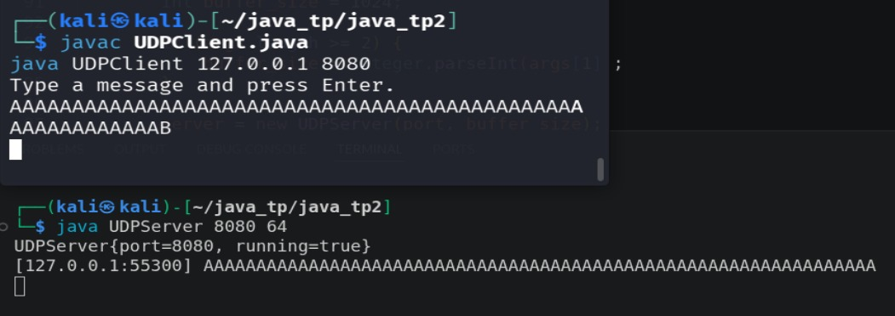
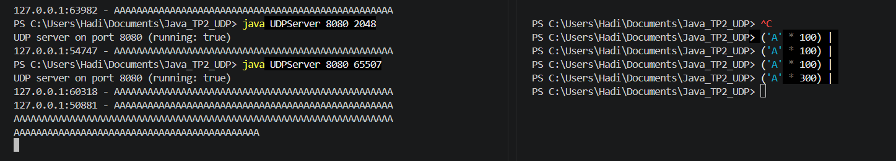
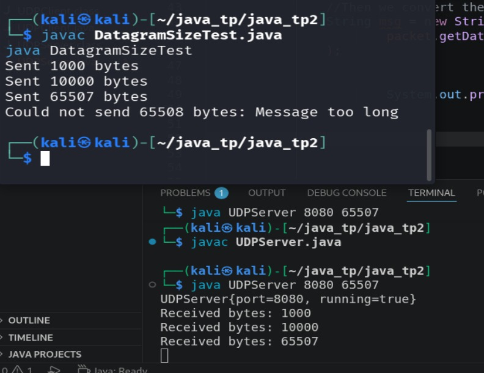
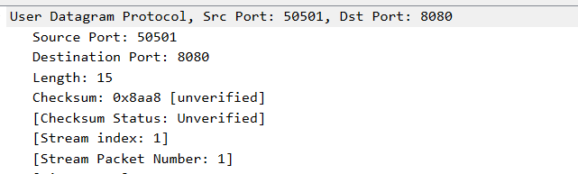

# Java for Networks — TP2: UDP Client and Server

## (Step 1) — UDP server

We wrote `UDPServer.java` to receive UDP messages and display each message with the sender's IP address and port. The server uses port 8080 by default.

## (Step 2) — Server test with Ncat

We used Ncat on Windows to send `Bonjour` to the server and confirmed that the server displayed the message.

## (Step 3) — UDP client

We wrote `UDPClient.java` to send each line typed in the terminal as a UTF-8 UDP datagram to the server address and port given on the command line.

## Step 4 — Two clients sending to the same server

What does the server display when two clients send messages to it?

The server displayed each message along with the sender's IP address and source port. Both clients ran on the same computer, so the server showed the same IP address, `127.0.0.1`, for both. Each client used a different source port, which made it possible to tell them apart.

## Step 5 — UDP receive buffer

With a 64-byte receive buffer, the server receives only the first 64 bytes of any longer datagram. The client receives no notification that the message was truncated. The remaining bytes are discarded, so there is no second datagram containing the rest of the message.

In the Kali test shown below, the client sends a message ending in `B`. The server runs with a 64-byte buffer and displays the leading `A` characters. The final `B` is absent from the server output.

The Kali capture shows the server receiving a long message with a 65,507-byte buffer.

We launched the server with receive buffers of 64, 2,048, and 65,507 bytes. The PowerShell inputs shown used 100 repeated `A` characters for each buffer and a second input of 300 characters with the 65,507-byte buffer.

| Receive buffer size (bytes) | A characters visible in the copied server output |
| ---: | ---: |
| 64 | 50 |
| 2,048 | 50 |
| 65,507 | 50 on the first line, 170 on the second |

The copied output shows shorter strings than expected across all three tests. These excerpts alone do not confirm the number of bytes received.

The Kali capture shows the server receiving a long message with a 65,507-byte buffer.

## Step 6 — Maximum UDP datagram size

On Kali, we started the server with `java UDPServer 8080 65507` and ran `java DatagramSizeTest` to send four UDP payloads.

| Payload attempted (bytes) | Client result | Bytes displayed by the server |
| ---: | --- | ---: |
| 1,000 | Sent | 1,000 |
| 10,000 | Sent | 10,000 |
| 65,507 | Sent | 65,507 |
| 65,508 | `Could not send 65508 bytes: Message too long` | No datagram received |

The largest payload that arrived was 65,507 bytes. With a standard 20-byte IPv4 header and an 8-byte UDP header, the maximum UDP payload is 65,535 − 20 − 8 = 65,507 bytes. The final attempt exceeded that limit by one byte.

The Windows run with `UDPSizeTest` showed the same limit. Windows reported `The message is larger than the maximum supported by the underlying transport: sendto` for the last send.

## Step 7 — UDP header and IPv4 fragmentation

### Two-PC test — Wireshark observations

The client at `10.104.118.248` sent UDP datagrams to the server at `10.104.118.93:8080`. Wireshark displayed the traffic using the filter `ip.addr == 10.104.118.248`.

| UDP payload (bytes) | Source port | IPv4 packets observed | Wireshark frames |
| ---: | ---: | ---: | --- |
| 100 | 53464 | 1 | 207 |
| 1,000 | 55090 | 1 | 446 |
| 6,500 | 58121 | 5 | 863–867 |

For the 6,500-byte payload, frames 863–866 show four IPv4 fragments with Identification 1526 and offsets of 0, 1,480, 2,960, and 4,440 bytes. Frame 867 carries the fifth fragment. Wireshark displays that frame as UDP with `Len=6500` because reassembly completes there.
The 6,500-byte payload plus the 8-byte UDP header occupies 6,508 bytes. On a link with a 1,500-byte MTU and a 20-byte IPv4 header, four full fragments carry 1,480 bytes each and the final fragment carries 588 bytes. For the 10,000-byte LAN payload requested in the lab, the same calculation gives an **expected count of seven fragments** if fragmentation is allowed.

### Loopback comparison and UDP header fields

On one Windows PC, we sent UDP payloads of 1,000 and 10,000 bytes to `127.0.0.1:8080` and captured the traffic on the loopback interface. Wireshark showed one IPv4 packet per datagram. Both packets had a fragment offset of zero and the More Fragments flag was clear.

| UDP payload (bytes) | UDP Length field (bytes) | IPv4 Total Length (bytes) | IPv4 packets observed |
| ---: | ---: | ---: | ---: |
| 1,000 | 1,008 | 1,028 | 1 |
| 10,000 | 10,008 | 10,028 | 1 |

The four UDP header fields are Source Port, Destination Port, Length, and Checksum. The destination port was 8080. The UDP Length field includes the 8-byte UDP header and the payload.

In the Wireshark screenshot, the source port is 50501, the destination port is 8080, the UDP Length field is 15 bytes, and the checksum is `0x8aa8` (unverified by Wireshark).

## Step 8 — Receive buffer and datagram size

### a. Why does the receiver choose the receive buffer size?

The receive buffer belongs to the receiving application. It allocates memory based on the message sizes it expects and the available memory. The sender chooses the datagram size. If that datagram is larger than the buffer passed to Java's receive call, the receiver gets only the bytes that fit and the rest are discarded.

### b. Why avoid UDP payloads larger than about 1,400 bytes?

A packet must fit within the smallest MTU along its route. With a 1,500-byte MTU, a standard 20-byte IPv4 header and an 8-byte UDP header leave 1,472 bytes for the payload. Around 1,400 bytes gives some headroom for extra headers. If the packet is too large, it may be fragmented or dropped. When fragmentation occurs, losing one fragment prevents the receiver from reassembling the whole datagram.

## Step 9. 